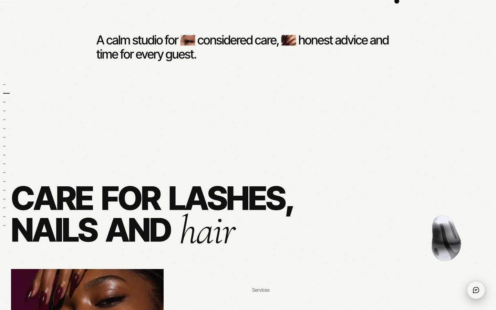

# Beauty Studio (demo)



A multilingual website template for a lash, nail and hair studio. It is built as a template: colours, type, texts, photos and contact details live in config files, so the next client is a day of work, not a rebuild.

## Highlights

- **Design tokens as the single source of truth**: palette, type scale, spacing and motion timings live in `src/styles/tokens.css`. Changing the primitives restyles the whole site.
- **Motion with intent**: GSAP and Lenis, split-text reveals, a liquid chrome WebGL shape, depth sections (tunnel, doors, card deck), a magnifier lens and a text scramble on hover.
- **Booking without a backend**: a step-by-step wizard (service, first and backup day, time of day, name) that prepares a WhatsApp message. Nothing is stored or sent to a server.
- **Three languages**: German (default), Ukrainian and English with `next-intl`.
- **SEO and security**: sitemap, manifest, structured data, security headers and a strict content security policy.

## Stack

Next.js 16, React 19, strict TypeScript, CSS Modules, GSAP, Lenis, next-intl. Node 20 or newer.

## Run it

```bash
npm install
npm run dev      # http://localhost:3000
npm run build
npm run start
```

## What to change for a client

| What | Where |
|---|---|
| Studio name, WhatsApp number, phone, email, Instagram, days off, booked dates | `src/config/site.ts` |
| Site address for SEO (sitemap, canonical) | environment variable `NEXT_PUBLIC_SITE_URL` on the host |
| Colours, font sizes, spacing, timings | `src/styles/tokens.css` |
| Fonts | `src/config/fonts.ts` |
| Photos | `src/config/images.ts` and `src/config/pool.ts`, files in `public/images` |
| Texts in three languages | `messages/de.json`, `messages/uk.json`, `messages/en.json` |
| Section anchors and menu | `src/config/sections.ts` |
| Demo mode (demo labels, demo Impressum and privacy texts) | `siteConfig.demo` in `src/config/site.ts`, set to `false` for a real client |
| Social preview images and icons | `python3 scripts/brand-assets.py` |
| Page transition (blink or curtain) | `siteConfig.transition` in `src/config/site.ts` |

Until values are set, the site shows neutral placeholders: prices "on request", hours "by appointment", region Münsterland.

## Before launch

Fill `src/config/site.ts`, replace the placeholders in `messages/*.json` (prices, hours, address, region, payment methods, cancellation terms), and set `siteConfig.demo` to `false`.
